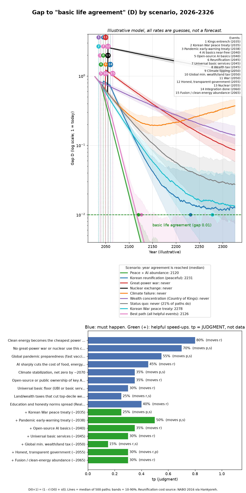
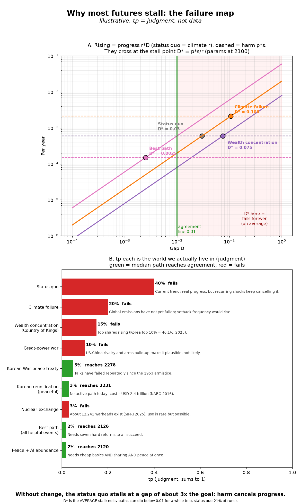

# Grok's Forecast

An illustrative model of how long humanity might take to reach agreement on basic life for everyone, and which futures (peace, war, Korean reunification, climate failure, wealth concentration) can get there at all.

**This is not a forecast of real events.** Every rate, event year and tp (judgment probability) is a guess. The few real facts used are cited in the code and output.

$$ D_{t+1} = (1-r)\,D_t + s_t $$

The gap D shrinks by the improvement rate r and grows with setbacks s. If setbacks outweigh progress (when the steady-state gap p·s/r stays above the threshold), agreement is never reached. Doing less harm matters as much as doing good.

- `realmode_future_decency.py`: base model
- `decency_scenarios_v2.py`: universality bound, sensitivity sweep, years-to-agreement, pathway (formula, conditions, events) and timeline scenarios (`self-test` runs the tests)
- `decency_chart.py`: draws the chart

## Why most futures fail forever

Each year, progress (r·D) shrinks as the gap gets smaller, while average harm (p·s) stays about the same. They meet at the stall point D* = p·s/r. If D* is above the 0.01 goal, that future never reaches agreement. The status quo stalls at about 3x the goal: harm cancels progress. The tp values (how likely each future is to be the one we live in) are judgments, not data.

> We live life through 0s and 1s. Just make sure you leave a 1 for the next 0.

Credit: humanity. Public domain (CC0).
